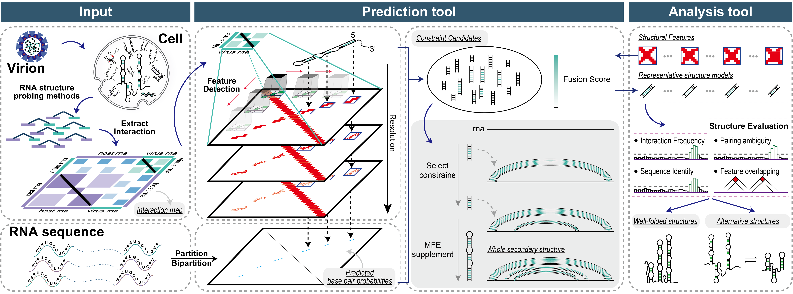

# RIVER: an integrated framework for inferring RNA secondary structures and their alternatives from RNA–RNA interaction maps

## Overview

`river-rna` is the command-line implementation of RIVER. It takes an RNA sequence and an RNA–RNA interaction map as input.

1. **Structural feature localization** extracts duplex-associated (anti-diagonal) patterns from the interaction background.
2. **Fusion-scoring** combines thermodynamic pairing probabilities with interaction support to score candidate base pairs.
3. **Representative structure assembly** turns the high-scoring candidates into complete secondary-structure models.

The same features and models are then used to identify interaction-supported **well-folded structures** and **alternative structures**.



Manuscript: **RIVER: duplex-morphology-guided inference of RNA secondary structures and their alternatives from RNA–RNA interaction maps**

## Installation

```bash
# environment.yml pins the tool versions used in the manuscript (RNAstructure 6.3, ViennaRNA 2.6.4, bedtools 2.30.0).
conda env create -f environment.yml
conda activate river

# installs RIVER and builds the optional accelerated extension (Cython/OpenMP kernel)
pip install .
# RIVER_NO_CYTHON=1 pip install .    # skip the kernel (NumPy fallback, identical results)
# pip install .[test]                # additionally installs pytest

# RNAstructure needs its thermodynamic tables
export DATAPATH=$PATH_PREFIX/share/rnastructure/data_tables

# check
river --version                      # 1.1.0
for exe in partition-smp bipartition-smp ProbabilityPlot Fold-smp RNAcofold bedtools; do
    command -v $exe || echo "MISSING: $exe"
done
echo "DATAPATH=$DATAPATH"
#RIVER checks the programs required by the requested steps before it starts and stops if one is missing.
```

## Input files

| input           | description                                                  | format   |
| --------------- | ------------------------------------------------------------ | -------- |
| RNA sequence    | one record per RNA; select it with `-s/--seq-id` if the file holds several. The sequence length is taken from the FASTA | `.fasta` |
| Interaction map | RNA–RNA contact map built from proximity-ligation data (RIC-seq, vRIC-seq, SPLASH, …) with Juicer tools. `-c/--chrom` is the chromosome name **inside** the `.hic` | `.hic`   |

The `.hic` must contain the resolutions required by the preset (10/5/1 bp for `short`/`medium`, 15/10/5/1 bp for `long`).

The data used in the manuscript are available at <https://github.com/xxTAT/RIVER>; predicted structures and attribute tables are browsable at <https://github.com/xxTAT/river-atlas>.

## Steps

| step | output directory                      | what it does                                                 | default | manuscript (Methods)                                         | Dependencies  |
| ---- | ------------------------------------- | ------------------------------------------------------------ | ------- | ------------------------------------------------------------ | ------------- |
| 1    | `step1_partition`                     | **base-pair probabilities** of the sequence (partition function) | ✓       | Fusion scoring of candidate base pairs                       | -             |
| 2    | `step2_structure_feature_detect`      | dumps the interaction matrices and locates **structural features** | ✓       | Structural feature localization                              | -             |
| 3    | `step3_optimal_structure_predict`     | **representative secondary structure of the whole RNA**      | -       | Fusion scoring of candidate base pairs; Representative structure assembly | steps 1 and 2 |
| 4    | `step4_cluster_structure_predict`     | **representative structure of every structural feature**     | -       | Representative structure assembly (*Feature-level structure reconstruction*) | steps 1 and 2 |
| 5    | `step5_alternative_structure_predict` | **alternative structures** from mutually exclusive features  | -       | Identification and evaluation of alternative structures      | steps 1 and 2 |
| 6    | `step6_local_wellfolded`              | **local well-folded structures**, screened from the step 4 structures | -       | Identification of well-folded structures (*Feature-derived (local) well-folded structures*) | step 4        |
| 7    | `step7_global_wellfolded`             | **global well-folded structures**, screened from the step 3 structure | -       | Identification of well-folded structures (*Unit-based (global) well-folded structures*) | step3         |

**Algorithm, inputs and outputs of every step: [`docs/steps.md`](source/1.1.0/docs/steps.md).**

## Usage

```bash
# run
# show the preset parameters (short | medium | long)
river presets [short|medium|long]

# default run (steps 1,2) with the preset parameters
river predict -f rna.fasta --hic map.hic -c <chrom> -o out/

# run every step
river predict -f rna.fasta --hic map.hic -c <chrom> -o out/ --steps 1,2,3,4,5,6,7 --n-clusters 7

# add steps to a finished run, reusing its intermediate files
river predict -f rna.fasta --hic map.hic -c <chrom> -o out/ --steps 4,6 --resume

# re-run one step after changing a parameter
river predict ... -o out/ --steps 3 --resume --max-pair-distance 2000

# reuse a parameter set
river predict ... -o out/ --config params.yaml
```

Parameters are resolved in three layer; each layer **overrides the previous one**:

```
preset (-r short|medium|long|auto)  →  --config params.yaml/.json  →  command-line options
```

`-r auto` (default) picks the preset from the sequence length: `short` < 1,000 nt ≤ `medium` < 10,000 nt ≤ `long`.

Every value actually used is written to `step0_prepare/run_config.json`.

All options and parameters, with their defaults in each preset: [`docs/parameters.md`](source/1.1.0/docs/parameters.md).

More worked examples: [`examples/QUICKSTART.md`](source/1.1.0/examples/QUICKSTART.md).

Python API:

```python
from river.cli import predict

predict("rna.fasta", "map.hic", "HS1", "out", rna_type="long",
        steps=(1, 2, 3, 4, 5, 6, 7), n_clusters=7, threads=16)
```

## Output

```
out/
├── river.log                                 # full log of the run
├── step0_prepare/run_config.json             # all parameters used
├── step1_partition/                          # base-pair probabilities
├── step2_structure_feature_detect/           # matrices, feature bedpe, clusters, step2_manifest.json
├── step3_optimal_structure_predict/
│   ├── summary.json                          # candidates; `representative` = lowest total │   │                                           free energy
│   └── structureN/merge_structure/whole_structure.{ct,bedpe,dbn}
├── step4_cluster_structure_predict/
│   ├── summary.json, all_cluster_structures.{tsv,bedpe}
│   ├── long_range/cluster_<s1>_<e1>_<s2>_<e2>/structureN/…
│   └── short_range/cluster_<s1>_<e1>_<s2>_<e2>/structureN/…
├── step5_alternative_structure_predict/
│   ├── conflict_scores.tsv, all_alternative_structures.{tsv,bedpe}, summary.json
│   └── <category>/conflict_K/…
├── step6_local_wellfolded/
│   ├── well_folded_{short,long}_range.bedpe, well_folded_all.bedpe
│   ├── scatter_{short,long}_range.txt
│   └── summary.json, thresholds.json
└── step7_global_wellfolded/
    ├── structural_units.tsv, cluster_stats.tsv
    ├── well_folded_units.{tsv,bedpe}
    └── summary.json
```

* `structureN.ct/.bedpe/.dbn` — a predicted structure. Two-fragment structures (RNAcofold) are written as two strands so that VARNA draws them separately.
* `structureN_annotation.txt` — interaction support of every nucleotide; `structureN_pairs.tsv` — support and pairing ambiguity of every base pair.
* `all_*_structures.bedpe` — all structures of a step in one file (name column `category|conflict|cluster|structureN`), ready for a genome browser.

The complete file list of every step is in [`docs/steps.md`](source/1.1.0/docs/steps.md).
